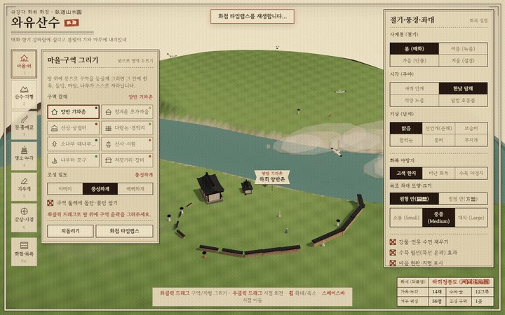
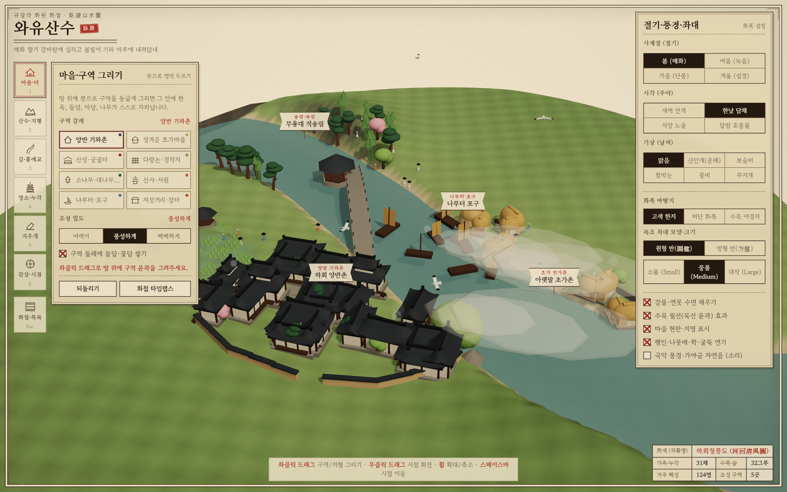
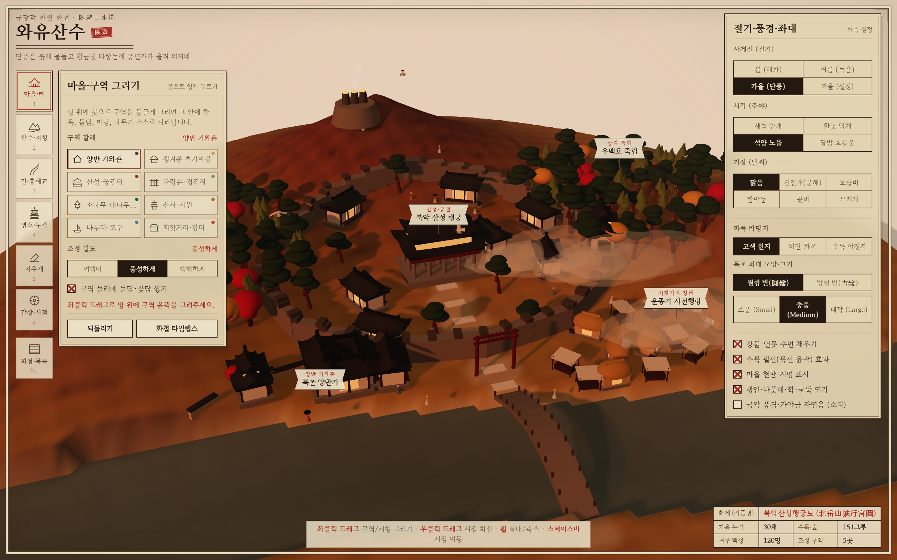
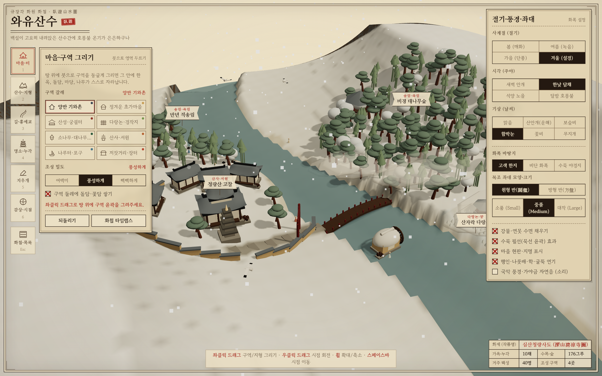
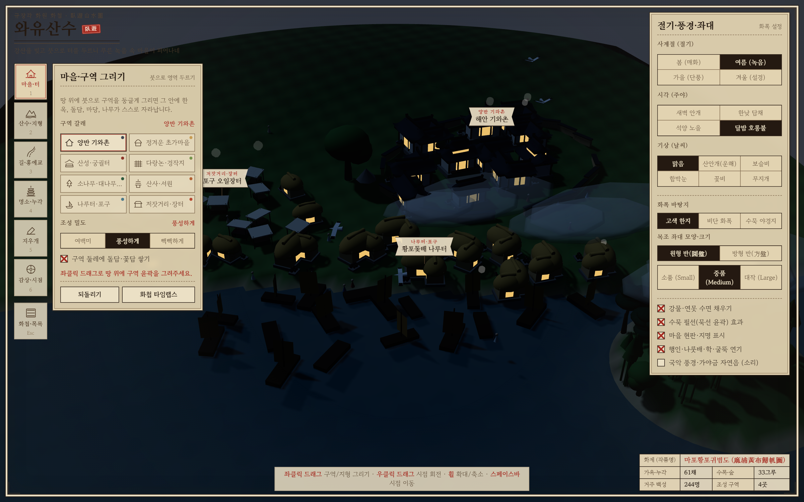

# ⛰️ 와유산수 (臥遊山水) — Wayu Sansu

> **"강산을 빚고 붓으로 터를 두르니, 한지 화폭 위에 작은 고을이 절로 피어나네"**  
> 브라우저에서 바로 즐기는 **한국 전통 마을 · 수묵담채 산수화 3D 디오라마 빌더**

[](https://jeiel85.github.io/wayu-sansu/)
[](https://threejs.org/)
[](https://vitejs.dev/)

---

## 🌐 라이브 데모 (Live Demo)

👉 **[https://jeiel85.github.io/wayu-sansu/](https://jeiel85.github.io/wayu-sansu/)**  
*(설치 없이 데스크톱·태블릿·모바일 웹 브라우저에서 바로 플레이할 수 있습니다.)*

<p align="center">
  
</p>

| 🌸 봄 · 하회청풍도 (매화와 기와촌) | 🍁 가을 · 북악산성행궁도 (단풍과 석양) |
| :---: | :---: |
|  |  |
| **❄️ 겨울 · 심산청량사도 (설경과 고찰)** | **🏮 달밤 · 마포황포귀범도 (호롱불 포구)** |
|  |  |

---

## 📖 작품 소개 (About)

**《와유산수(臥遊山水)》**는 옛 선비들이 방 안에 누워 산수화를 감상하며 자연을 유람하던 '와유(臥遊)'의 풍류를 웹 3D 디오라마로 재해석한 코지(Cozy) 샌드박스 빌더입니다.

회전하는 전통 화류목·유기 좌대(Turntable) 위에 산봉우리를 솟구치게 하거나 물길을 파내고, **땅 위에 붓으로 구역(Zone)을 둥글게 그리기만 하면** 그 안에 팔작지붕 한옥, 정겨운 초가집, 꽃담과 장독대, 다랑논, 적송 소나무 숲, 황포돛배가 스스로 쑥쑥 자라납니다.

---

## ✨ 핵심 기능 (Key Features)

### 1. 🖌️ 붓으로 그리면 스스로 자라나는 8가지 전통 구역 (Growing Zones)
모필 묵선 브러시로 지형 위에 영역을 두르면 탄성 애니메이션과 함께 전통 건축물과 자연물이 절차적(Procedural)으로 생성됩니다.

| 구역 이름 | 생성되는 요소 |
| :--- | :--- |
| **🏡 양반 기와촌** | 버선코 처마 곡선의 한옥 기와집 (`ㅡ자`, `ㄱ자`, `ㅁ자 대가집`, `누마루 별당`), 꽃담·기와담, 장독대, 매화·소나무 |
| **🌾 정겨운 초가마을** | 둥근 볏짚 초가지붕과 용구새, 황토벽, 툇마루, 옹기 장독대, 돌담 |
| **🏯 산성·궁궐터** | 구역 외곽을 따라 자동으로 축조되는 성곽(여장)과 문루, 중심 수상 대누각과 전각 |
| **🌱 다랑논·경작지** | 계단식 물논 단차 자동 보정, 계절별 벼 포기(봄·여름 청벼, 가을 황금들녘), 원두막 |
| **🌲 소나무·대나무숲** | 구불구불한 한국 적송(소나무), 푸른 대나무 군락(죽림), 사계절 활엽수 |
| **🛕 산사·서원** | 대웅전/강당 본전, 오층석탑, 산사 돌담과 고목 은행나무·배롱나무 |
| **⛵ 나루터·포구** | 물가에 그리면 수면 위에 흔들리는 **황포돛배(나룻배)**와 강변 주막이 자동 배치 |
| **🏮 저잣거리·장터** | 천막 차양 좌판, 곡식 자루, 보부상 주막과 활기찬 장터 풍경 |

### 2. ⛰️ 산수 지형 조형 & 등고 묵선 (Terrain & Ink Contours)
- **6가지 산수 브러시**: `산 융기`, `강·연못 파기`, `계단 단차(다랑논)`, `다듬기`, `평지 고르기`, `기암괴석(암벽 준법)`
- 고도와 경사에 따라 수묵담채 색채와 암벽 질감이 입혀지며, 고지도(대동여지도) 감성의 **등고 묵선과 수변 먹선**이 실시간으로 그려집니다.

### 3. 🌉 오솔길·박석길과 자동 무지개 돌다리 (Roads & Auto-Bridges)
- 지형 위를 드래그하면 `황토 오솔길`, `박석 돌길`, `어도·대로`가 놓이고 가파른 경사에는 자동으로 **돌계단**이 생성됩니다.
- 강이나 연못 위를 가로질러 길을 그으면 수면 구간을 인식해 **무지개 돌다리(홍예교)** 또는 **전통 나무다리(목교)**가 자동으로 세워집니다.

### 4. 🏛️ 8가지 단독 명소·누각 배치 (Landmarks)
- `수상 대누각(경회루)`, `다층 오층석탑`, `육모정(전통 정자)`, `물레방앗간(실시간 회전 수차)`, `당산나무와 성황당`, `산성 봉수대(연기 피어오름)`, `홍살문`, `천하대장군 장승·돌하르방`을 원하는 위치와 방향(`R` 키 회전)으로 세울 수 있습니다.

### 5. 🌸 사계절 · 주야 호롱불 · 기상 변화 · 국악 자연음
- **사계절(절기)**: 봄(매화·꽃비), 여름(짙은 녹음), 가을(붉은 단풍·황금 은행·황금 벼), 겨울(설경·눈 덮인 기와와 초가)
- **시각(주야)**: `새벽 안개`, `한낮 담채`, `석양 노을`, 그리고 **한옥 창호지마다 따뜻한 호롱불이 켜지는 `달밤 호롱불`**
- **기상(날씨)**: `맑음`, `산안개(운해)`, `보슬비`, `함박눈`, `꽃비`, `수채화 무지개`
- **생동감 & 국악 사운드**: 마을 길을 거니는 **갓 쓴 선비와 백성들**, 창공을 선회하는 **단정학(두루미)**, 굴뚝 연기, 그리고 **Web Audio API**로 실시간 합성되는 **가야금 5음계(궁·상·각·치·우) 현악음과 산사 풍경소리**

### 6. 📜 4대 명승지 초본 & 타임랩스 · 엽서 갈무리
- 시작 시 바로 감상하고 수정할 수 있는 4종의 명승지 프리셋 탑재:
  1. **안동 하회마을 (`하회청풍도`)**: S자 물돌이 강변과 부용대 절벽, 양반 기와촌과 초가마을, 홍예교
  2. **산성 행궁과 다랑논 고을 (`북악산성행궁도`)**: 성곽으로 둘러싸인 행궁과 운종가 시전행랑, 봉수대
  3. **깊은 산사와 대나무 협곡 (`심산청량사도`)**: 협곡 위 청량산 고찰과 대나무숲, 목교와 물레방앗간
  4. **황포돛배 뜨는 나루터 장터 (`마포황포귀범도`)**: 포구 오일장터와 다도해 학도(鶴島) 솔섬
- **화첩 타임랩스**: 처음부터 마을이 지어지는 과정을 순서대로 애니메이션 재생
- **화첩 엽서 갈무리 (PNG)** 및 **JSON 파일 저장/불러오기** 지원

---

## 🎮 조작 방법 (Controls)

| 동작 | 조작키 / 마우스 |
| :--- | :--- |
| **구역 / 지형 / 길 그리기** | `마우스 좌클릭 드래그` |
| **좌대 시점 회전 (Orbit)** | `마우스 우클릭 드래그` (또는 `감상·시점(6)` 모드에서 좌클릭) |
| **화면 이동 (Pan)** | `마우스 휠 클릭 드래그` 또는 `Space` 누른 채 드래그 |
| **확대 / 축소 (Zoom)** | `마우스 휠 스크롤` |
| **도구 빠른 전환** | `1` 마을·터 · `2` 산수·지형 · `3` 길·홍예교 · `4` 명소·누각 · `5` 지우개 · `6` 감상 |
| **명소 방향 회전** | `R` 키 (45°씩 회전) |
| **마을 지명(현판) 변경** | 구역 위에 떠 있는 **현판 리본 클릭** |
| **실행 취소 (Undo)** | `Ctrl + Z` (또는 좌측 패널 `되돌리기` 버튼) |
| **화첩 메뉴 / 초본 불러오기** | `Esc` 키 |

---

## 🛠️ 기술 스택 (Tech Stack)

- **3D Engine**: [Three.js](https://threejs.org/) (Custom Procedural BufferGeometry Hanok Roofs, Vertex-Colored Heightmap Terrain, Shadow Mapping, Particle & Mist Systems)
- **2D Overlay**: HTML5 Canvas (`#inkLayer` — 모필 먹선 브러시 드로잉 및 한지 발무늬 비네팅)
- **Audio**: Web Audio API Procedural Synthesizer (가야금 농현 현악 플럭, 산사 풍경 배음, 계곡 바람 노이즈)
- **Build Tool**: [Vite](https://vitejs.dev/) (Vanilla ES Modules, Zero external asset dependencies)

---

## 🚀 로컬 실행 방법 (Getting Started)

```bash
# 1. 저장소 클론
git clone https://github.com/jeiel85/wayu-sansu.git
cd wayu-sansu

# 2. 패키지 설치
npm install

# 3. 개발 서버 실행 (http://localhost:5173)
npm run dev

# 4. 프로덕션 빌드
npm run build
```

---

## 📄 라이선스 (License)

MIT License © 2026 jeiel85
